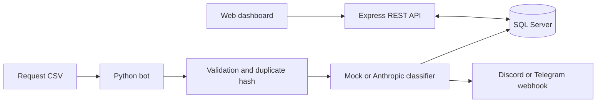
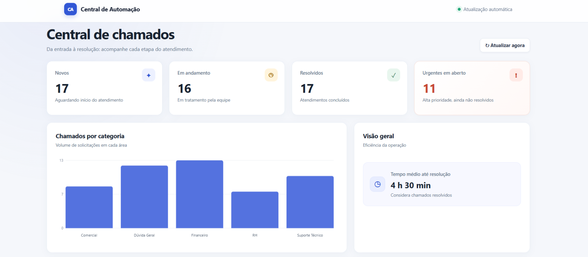
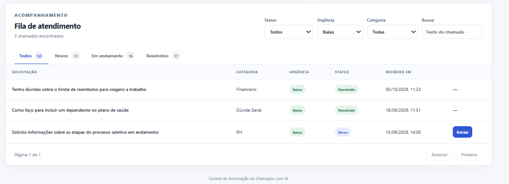
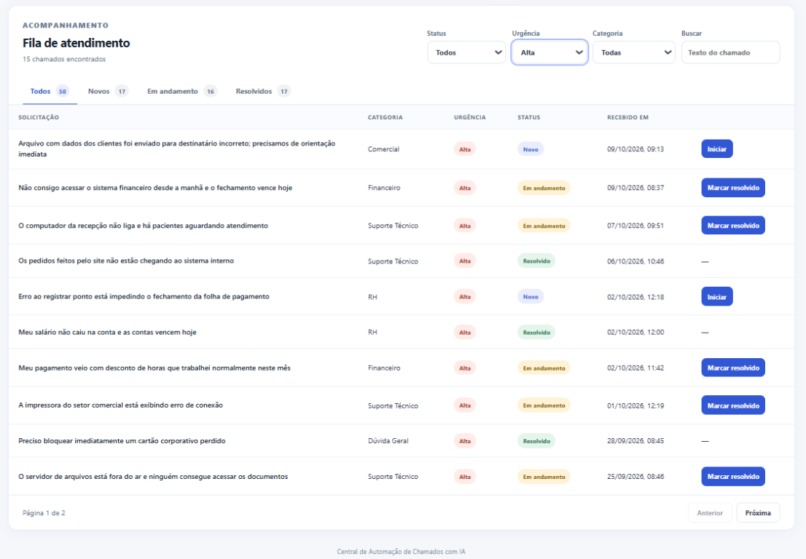

# AI-Powered Ticket Automation Hub

[Leia em português](README.md)

A portfolio project that automates the triage of requests received through email, spreadsheets, or forms. A Python bot imports tickets from a CSV file, classifies their category and urgency, stores them in SQL Server, and notifies the team about high-priority requests. The Node.js REST API supports ticket queries and status updates, while a lightweight web dashboard displays metrics and the service queue.

## Workflow



See the detailed workflow diagram in [docs/diagrama-fluxo.md](docs/diagrama-fluxo.md) (currently in Portuguese).

## Dashboard preview

Screenshots from the demo show the control dashboard, complete queue, working filters, and high-priority requests:








## Tech stack

- **Bot:** Python 3.10+, requests, pyodbc, python-dotenv, and pytest.
- **Classification:** local keyword rules in mock mode or the Anthropic Messages API.
- **API:** Node.js 20, Express, mssql, and Zod; Jest and Supertest for tests.
- **Database:** SQL Server 2022 Developer, with SQL Server scripts under `db/`.
- **Dashboard:** plain HTML, CSS, and JavaScript; no front-end framework.
- **Runtime:** Docker Compose.
- **CI:** GitHub Actions runs Python and Node.js tests on pushes and pull requests.

## Run the project

Prerequisites: Docker Desktop with Compose v2 and enough disk space for the SQL Server image.

The following steps are for anyone cloning the repository and running the local demo with Docker Compose.

1. From the repository root, create a local copy of the example configuration:

   ```sh
   cp .env.example .env
   ```

   In Windows PowerShell, use:

   ```powershell
   Copy-Item .env.example .env
   ```

2. Edit `.env` and replace `ChangeThis_StrongPassword123!` with a strong password for your local environment in both `MSSQL_SA_PASSWORD` and `DB_PASSWORD`. The values must match. Keep `CLASSIFIER_MODE=mock`; no Anthropic API key is needed for the demo.

3. Start the services in the background:

   ```powershell
   docker compose up --build -d
   ```

Once the services have started, open <http://localhost:3000>. The first run may take a few minutes while Docker downloads the SQL Server image and initializes the database. The bot imports the 50 sample tickets once and exits; a demo-data step assigns statuses, creates simulated status history, and distributes timestamps across recent business days and working hours. The API and database remain running.

In the dashboard, the **Novos** (New), **Em andamento** (In progress), and **Resolvidos** (Resolved) tabs open their respective queues. Use **Iniciar** (Start) to move a ticket to the in-progress queue and **Marcar resolvido** (Mark resolved) to complete it. Status, urgency, category, and text filters can be combined.

Run `docker compose ps` to check service status and `docker compose logs -f` to follow logs. Run `docker compose down` to stop the containers; data remains in the `sqlserver-data` volume. `docker compose down -v` also deletes the persisted local database.

## Configuration

All variables are listed and documented in [.env.example](.env.example). The `.env` file is local and must not be committed.

| Variable | Development default | Description |
|---|---|---|
| `MSSQL_SA_PASSWORD` | Example value; **replace it** | Initial `sa` password for the SQL Server image. |
| `DB_HOST` | `db` | SQL Server host. In Compose, the API and bot use the internal service name `db`. |
| `DB_PORT` | `1433` | SQL port published on the host machine. |
| `DB_NAME` | `CentralAutomacao` | Application database name. |
| `DB_USER` | `sa` | SQL user used by the API and bot. |
| `DB_PASSWORD` | Example value; **must match `MSSQL_SA_PASSWORD`** | Password used by application services to connect to SQL Server. |
| `PORT` | `3000` | HTTP port for the API and dashboard. |
| `CORS_ORIGIN` | `*` | Allowed origins, comma-separated, or `*` for any origin. |
| `LOG_LEVEL` | `info` | Reserved for log-level configuration. |
| `SOURCE_TYPE` | `csv` | Currently supported bot source. |
| `CSV_PATH` | `/app/data/exemplo_chamados.csv` | CSV path inside the container. |
| `CLASSIFIER_MODE` | `mock` | `mock` uses local rules; `anthropic` calls the Anthropic API. |
| `ANTHROPIC_API_KEY` | Empty | Secret key required only in `anthropic` mode. |
| `ANTHROPIC_MODEL` | `claude-3-5-haiku-latest` | Anthropic model identifier. |
| `ANTHROPIC_TIMEOUT_SECONDS` | `20` | Classifier request timeout. |
| `BOT_INTERVAL_SECONDS` | `0` | `0` runs once; a positive value repeats collection at that interval. |
| `ALERT_PROVIDER` | Empty | Empty disables alerts; use `discord` or `telegram`. |
| `ALERT_WEBHOOK_URL` | Empty | Discord webhook URL. |
| `TELEGRAM_BOT_TOKEN` | Empty | Telegram bot token. |
| `TELEGRAM_CHAT_ID` | Empty | Telegram alert destination. |

To enable live classification after verifying mock mode, set `CLASSIFIER_MODE=anthropic` and provide `ANTHROPIC_API_KEY`. Never commit real credentials.

## REST API

Local base URL: `http://localhost:3000`.

| Method and route | Description |
|---|---|
| `GET /health` | Checks the API and database connection. |
| `GET /api/chamados` | Lists tickets; accepts `status`, `urgencia`, `categoria`, `busca`, `page`, `limit`, `sort`, and `order`. Filter values are in Portuguese, e.g. `status=novo` and `urgencia=alta`. |
| `GET /api/chamados/:id` | Returns ticket details and status history. |
| `PATCH /api/chamados/:id/status` | Advances through `novo → em_andamento → resolvido` (new → in progress → resolved). |
| `GET /api/metricas` | Returns totals by status, category, and urgency, open high-priority tickets, and average resolution time. |
| `GET /api/logs?limit=20` | Returns recent bot logs. |

Examples:

```powershell
curl.exe "http://localhost:3000/health"
curl.exe "http://localhost:3000/api/chamados?status=novo&urgencia=alta&page=1&limit=10"
curl.exe "http://localhost:3000/api/chamados/1"
curl.exe -X PATCH "http://localhost:3000/api/chamados/1/status" `
  -H "Content-Type: application/json" `
  -d '{\"status\":\"em_andamento\"}'
curl.exe "http://localhost:3000/api/metricas"
curl.exe "http://localhost:3000/api/logs?limit=10"
```

Errors use the JSON format `{ "erro": "...", "detalhes": [...] }`. Invalid filters return `400`; an invalid status transition returns `422`.

## Run tests locally

### Node.js API

Requires Node.js 20 or later:

```powershell
Set-Location api
npm ci
npm test
```

Tests use a mocked service and do not require SQL Server.

### Python bot

Requires Python 3.10 or later:

```powershell
py -3.10 -m venv .venv
.\.venv\Scripts\Activate.ps1
python -m pip install -r bot\requirements.txt
python -m pytest bot\tests -q
```

The Anthropic classifier and webhooks are tested with mocked HTTP calls. The test suite requires no external keys or database.

## Database

`db/01_schema.sql` and `db/02_seed.sql` create the tables and initial categories; they can be reapplied without recreating existing objects. See [docs/modelo-dados.md](docs/modelo-dados.md) for the schema, keys, constraints, and indexes (currently in Portuguese). Reference queries are in `db/queries_uteis.sql`.

## Technical decisions

- **SQL Server:** fits enterprise integration scenarios and demonstrates SQL, constraints, transactions, and indexes in a reproducible container.
- **Mock mode by default:** makes the workflow testable and demonstrable without an API key, cost, or dependency on an external AI provider's availability. The live classifier requires explicit configuration.
- **SHA-256 hash of normalized text:** prevents the bot from inserting the same content again when it reprocesses a source; a database `UNIQUE` constraint also protects against concurrent duplicates.
- **Transaction per ticket:** a failure while classifying or saving one item does not stop the rest of the batch. Initial history and each status change are stored alongside the ticket.
- **Framework-free dashboard:** keeps the interface small and served by the API process, without a separate front-end build.

More context is available in [docs/decisoes.md](docs/decisoes.md) (currently in Portuguese).

## Dependency advisory

`npm audit --omit=dev` reports a moderate vulnerability (GHSA-hp3w-g68c-fv3c) in `sprintf-js`, a transitive dependency of the SQL Server driver `mssql` via `tedious`. At the time of verification, the affected range includes the latest available `sprintf-js` version (`1.1.3`), and npm's automatic fix downgrades `mssql` to `4.2.0`, which is incompatible with this application. No such downgrade was applied. The test suite uses Jest 30, which removed the high-severity alerts found in the previous version; the full audit still reports moderate alerts in production and test dependency trees because they depend on affected versions of the same package. Recheck the advisory and update the dependency chains when compatible fixed releases become available.

## Future improvements

- Add a message queue to absorb traffic spikes and decouple collection from classification.
- Add JWT authentication, role-based authorization, and API rate limiting.
- Add collectors for email/IMAP, forms, and third-party APIs.
- Add versioned database migrations.
- Deploy to the cloud with managed secrets, observability, and operational alerts.
- Collect human feedback to measure and improve classification quality.

## Local demo results

Values retrieved from the local run on 2026-10-10. The demo uses 50 fictional requests from the CSV; the demo-data script assigns statuses and creates simulated status history. These figures demonstrate the system's behavior and do not represent production operations or a benchmark.

| Metric | Result |
|---|---:|
| Tickets loaded | 50 |
| New / in progress / resolved | 17 / 16 / 17 |
| High-urgency tickets | 15 (11 still open) |
| Average time to resolution | 4 h 30 min (simulated history) |

Bot execution time and classification accuracy have not been measured. Accuracy requires a labeled ticket set for comparison, and execution time depends on the environment. External alert delivery is also not measured in this demo because webhooks are disabled by default.
