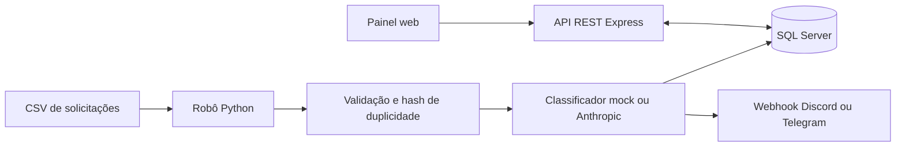

# Central de Automação de Chamados com IA

Projeto de portfólio para automatizar a triagem de solicitações recebidas por e-mail, planilha ou formulário. Um robô Python importa chamados de CSV, classifica categoria e urgência, grava os dados no SQL Server e notifica a equipe sobre itens urgentes. A API Node.js oferece consulta e atualização de chamados; um painel web simples apresenta métricas e fila de atendimento.

## Fluxo



O diagrama detalhado está em [docs/diagrama-fluxo.md](docs/diagrama-fluxo.md).

## Stack

- **Robô:** Python 3.10+, requests, pyodbc, python-dotenv e pytest.
- **Classificação:** regras locais no modo mock ou Anthropic Messages API.
- **API:** Node.js 20, Express, mssql e Zod; Jest e Supertest para testes.
- **Banco:** SQL Server 2022 Developer, com scripts SQL Server em `db/`.
- **Painel:** HTML, CSS e JavaScript sem framework.
- **Execução:** Docker Compose.
- **CI:** GitHub Actions testa Python e Node.js em pushes e pull requests.

## Executar o projeto

Pré-requisitos: Docker Desktop com Compose v2 e espaço em disco para a imagem do SQL Server.

Os passos abaixo são para qualquer pessoa que clone o repositório e queira executar a demonstração local com Docker Compose.

1. Na raiz do repositório, crie uma cópia local da configuração de exemplo:

   ```sh
   cp .env.example .env
   ```

   No Windows PowerShell, o comando equivalente é:

   ```powershell
   Copy-Item .env.example .env
   ```

2. Edite `.env` em um editor de texto e troque `ChangeThis_StrongPassword123!` por uma senha forte escolhida para o ambiente local, tanto em `MSSQL_SA_PASSWORD` quanto em `DB_PASSWORD`. Os dois valores precisam ser iguais. Mantenha `CLASSIFIER_MODE=mock`; não é necessária chave Anthropic para a demonstração.

3. Inicie os serviços em segundo plano:

   ```powershell
   docker compose up --build -d
   ```

Após a primeira inicialização, abra <http://localhost:3000>. O SQL Server precisa baixar a imagem e inicializar o banco, então a primeira execução pode levar alguns minutos. O robô importa os 50 chamados de exemplo uma vez e termina; a API e o banco ficam ativos.

Para conferir o estado dos serviços, execute `docker compose ps`. Para acompanhar os logs, execute `docker compose logs -f`. Para encerrar os containers, execute `docker compose down`; os dados permanecem no volume `sqlserver-data`. `docker compose down -v` também apaga o banco local persistido.

## Configuração

Todas as variáveis estão listadas e comentadas em [.env.example](.env.example). O arquivo `.env` é local e não deve ser commitado.

| Variável | Padrão de desenvolvimento | Descrição |
|---|---|---|
| `MSSQL_SA_PASSWORD` | valor de exemplo; **substituir** | Senha inicial do `sa` na imagem do SQL Server. |
| `DB_HOST` | `db` | Host do SQL Server para execução local/container. No Compose, API e robô usam o nome interno `db`. |
| `DB_PORT` | `1433` | Porta SQL publicada no computador anfitrião. |
| `DB_NAME` | `CentralAutomacao` | Banco de dados da aplicação. |
| `DB_USER` | `sa` | Usuário SQL usado pela API e pelo robô. |
| `DB_PASSWORD` | valor de exemplo; **igual a `MSSQL_SA_PASSWORD`** | Senha usada pelos serviços para se conectar ao SQL Server. |
| `PORT` | `3000` | Porta HTTP da API e do painel. |
| `CORS_ORIGIN` | `*` | Origens permitidas, separadas por vírgula, ou `*` para qualquer origem. |
| `LOG_LEVEL` | `info` | Reserva para configuração do nível de logs. |
| `SOURCE_TYPE` | `csv` | Fonte atualmente suportada pelo robô. |
| `CSV_PATH` | `/app/data/exemplo_chamados.csv` | Caminho do CSV dentro do container. |
| `CLASSIFIER_MODE` | `mock` | `mock` usa regras locais; `anthropic` chama a API da Anthropic. |
| `ANTHROPIC_API_KEY` | vazio | Chave secreta necessária somente no modo `anthropic`. |
| `ANTHROPIC_MODEL` | `claude-3-5-haiku-latest` | Identificador do modelo Anthropic. |
| `ANTHROPIC_TIMEOUT_SECONDS` | `20` | Timeout da chamada ao classificador. |
| `BOT_INTERVAL_SECONDS` | `0` | `0` executa uma vez; valor positivo repete a coleta nesse intervalo. |
| `ALERT_PROVIDER` | vazio | Vazio desabilita alertas; use `discord` ou `telegram`. |
| `ALERT_WEBHOOK_URL` | vazio | URL do webhook de Discord. |
| `TELEGRAM_BOT_TOKEN` | vazio | Token do bot de Telegram. |
| `TELEGRAM_CHAT_ID` | vazio | Destino dos alertas de Telegram. |

Para habilitar classificação real depois de validar o modo mock, defina `CLASSIFIER_MODE=anthropic` e preencha `ANTHROPIC_API_KEY`. Nunca inclua chaves reais no repositório.

## API REST

Base URL local: `http://localhost:3000`.

| Método e rota | Descrição |
|---|---|
| `GET /health` | Verifica API e conexão ao banco. |
| `GET /api/chamados` | Lista chamados; aceita `status`, `urgencia`, `categoria`, `busca`, `page`, `limit`, `sort` e `order`. |
| `GET /api/chamados/:id` | Retorna dados do chamado e histórico de status. |
| `PATCH /api/chamados/:id/status` | Avança `novo → em_andamento → resolvido`. |
| `GET /api/metricas` | Totais por status, categoria e urgência, urgentes abertos e tempo médio de resolução. |
| `GET /api/logs?limit=20` | Retorna logs recentes do robô. |

Exemplos:

```powershell
curl.exe "http://localhost:3000/health"
curl.exe "http://localhost:3000/api/chamados?status=novo&urgencia=alta&page=1&limit=10"
curl.exe "http://localhost:3000/api/chamados/1"
curl.exe -X PATCH "http://localhost:3000/api/chamados/1/status" `
  -H "Content-Type: application/json" `
  -d '{\"status\":\"em_andamento\"}'
curl.exe "http://localhost:3000/api/metricas"
curl.exe "http://localhost:3000/api/logs?limit=10"
```

Erros seguem o formato JSON `{ "erro": "...", "detalhes": [...] }`. Filtros fora dos valores permitidos retornam `400`; uma transição de status não permitida retorna `422`.

## Testes locais

### API Node.js

Requer Node.js 20 ou superior:

```powershell
Set-Location api
npm ci
npm test
```

Os testes usam serviço mockado; não precisam de banco SQL Server.

### Robô Python

Requer Python 3.10 ou superior:

```powershell
py -3.10 -m venv .venv
.\.venv\Scripts\Activate.ps1
python -m pip install -r bot\requirements.txt
python -m pytest bot\tests -q
```

O classificador Anthropic e os webhooks são testados com chamadas HTTP mockadas. Nenhuma chave externa ou banco é necessário para a suíte.

## Banco de dados

Os scripts `db/01_schema.sql` e `db/02_seed.sql` criam as tabelas e as categorias iniciais; podem ser reaplicados sem recriar objetos existentes. O esquema, chaves, constraints e índices estão descritos em [docs/modelo-dados.md](docs/modelo-dados.md). Consultas de referência estão em `db/queries_uteis.sql`.

## Decisões técnicas

- **SQL Server:** atende ao contexto de integrações corporativas da vaga e permite demonstrar SQL, constraints, transações e índices com um banco reproduzível em container.
- **Modo mock por padrão:** permite testar e demonstrar o fluxo sem chave, custo ou dependência de disponibilidade de um provedor de IA. O classificador real é uma configuração explícita.
- **Hash SHA-256 do texto normalizado:** impede inserir novamente o mesmo conteúdo quando o robô reprocessa a fonte; a constraint `UNIQUE` no banco protege contra duplicidade concorrente.
- **Transação por chamado:** uma falha ao classificar ou salvar um item não interrompe o restante do lote. O histórico inicial e cada mudança de status acompanham o chamado.
- **Painel sem framework:** mantém a interface pequena e servida pelo mesmo processo da API, sem dependências de build front-end.

Mais contexto: [docs/decisoes.md](docs/decisoes.md).

## Nota de dependência

O `npm audit --omit=dev` sinaliza uma vulnerabilidade moderada (GHSA-hp3w-g68c-fv3c) em `sprintf-js`, dependência transitiva do driver SQL Server `mssql` via `tedious`. Na verificação atual, a faixa afetada inclui a última versão disponível do `sprintf-js` (`1.1.3`), e o npm só oferece correção automática rebaixando `mssql` para `4.2.0`, uma quebra incompatível com a aplicação. Não forcei esse downgrade. A suíte usa Jest 30, atualização que remove os alertas altos encontrados na versão anterior; o audit completo ainda aponta alertas moderados nas árvores transitivas de produção e de testes por dependerem de versões afetadas do mesmo pacote. Reavalie o advisory e atualize as cadeias quando os mantenedores publicarem versões corrigidas compatíveis.

## Melhorias futuras

- Enfileirar solicitações em uma fila de mensagens para absorver picos e desacoplar coleta e classificação.
- Adicionar autenticação JWT, autorização por perfil e rate limiting na API.
- Criar coletores para e-mail/IMAP, formulários e APIs de terceiros.
- Adicionar migrações versionadas para evolução do schema.
- Implantar em nuvem com segredos gerenciados, observabilidade e alertas operacionais.
- Registrar feedback humano para medir e melhorar a qualidade das classificações.

## Métricas reais

Preencha esta seção com medições obtidas em execuções reais; os dados abaixo não são resultados de produção.

| Indicador | Medição |
|---|---|
| Chamados processados | A preencher |
| Tempo médio de execução | A preencher |
| Precisão da classificação (avaliada manualmente) | A preencher |
| Duplicados evitados | A preencher |
| Alertas urgentes entregues | A preencher |
