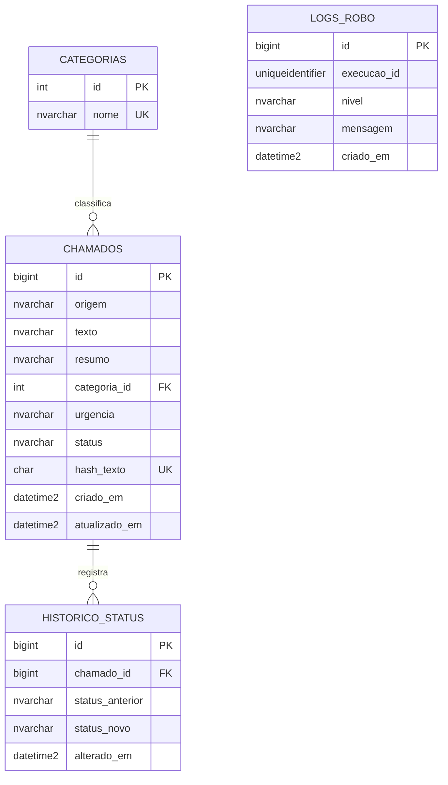

# Modelo de dados

## Entidades

## Tabelas e regras

- **`categorias`**: catálogo com `nome` único. O seed inclui Financeiro, Suporte Técnico, Comercial, RH e Dúvida Geral.
- **`chamados`**: conteúdo original, resumo, categoria e urgência; inicia com status `novo`. `urgencia` aceita `baixa`, `media` ou `alta`; `status` aceita `novo`, `em_andamento` ou `resolvido`. O hash SHA-256 do texto normalizado é único para deduplicação.
- **`historico_status`**: trilha append-only das mudanças. A inserção do chamado também registra o status inicial `novo` com `status_anterior` nulo. Atualizações posteriores são gravadas na mesma transação do chamado.
- **`logs_robo`**: mensagens por execução identificada por UUID, com nível e timestamp UTC.

## Índices

`chamados` possui índices em `status`, `urgencia`, `categoria_id` e `criado_em`; o histórico é indexado por chamado e data. Logs são indexados por execução e data.

## Inicialização

`01_schema.sql` cria as tabelas e os índices se ainda não existirem. `02_seed.sql` insere somente as categorias ausentes. Ambos podem ser executados novamente.
